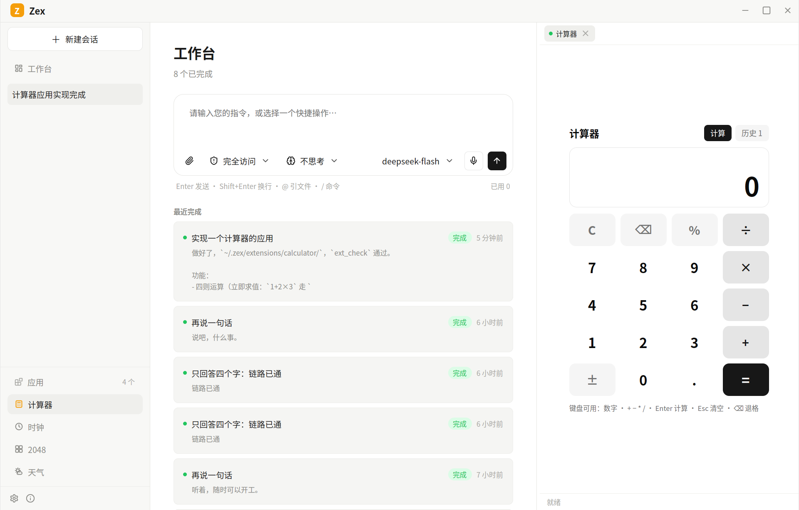

<p align="center">
  
</p>

# Zex

Zex 是一个运行在本机的桌面数字助理，使用 Rust 与 gpui 实现，模型侧支持 OpenAI 兼容接口与
Anthropic 接口。它具备文件读写、命令执行、网页抓取、子智能体并行执行与应用面板扩展能力。

当前仅在 Linux 上完成实际运行验证。Windows 与 macOS 已纳入 CI，编译与测试通过，但界面
尚未在这两个平台验证。



*实际运行截图。右侧的计算器是 Zex 按对话要求自行实现并挂载的应用，
代码位于 `~/.zex/extensions/calculator/`，不参与本项目构建。*

## 设计取舍

现有聊天客户端大多以对话界面加若干工具调用为主，其余交由用户处理。对于一个允许修改文件的
助理，更具决定性的部分是另外三项：允许执行的操作范围、长任务的上下文预算、进程重启后的
状态恢复。这三项构成了本仓库的主要代码量，界面层相对轻量。

## 已实现的功能

- 多会话并行执行，互不影响；任务进入队列，工作台展示运行中、排队与待处理事项
- 对话中展示工具调用的参数与结果；修改类与影响类操作按风险等级请求确认
- 右侧面板提供文件预览、应用面板与子智能体状态，宽度可调整
- 输入区支持 Enter 发送、Shift+Enter 换行、@ 引用文件、/ 调用命令，以及语音输入
  （录音后转写为文本）
- 每轮可选择运行模式（变更前确认、自动编辑、计划模式、完全访问）与思考强度，
  也可为单个会话指定模型
- 工具集包括 `fs_read`、`fs_write`、`shell`、`web_fetch`、`load_skill`、
  五个子智能体工具（`spawn_agent`、`team_status`、`wait_for_agents`、`send_message`、
  `terminate_agent`）、`control_panel`，以及四个应用管理工具（`ext_check`、`ext_logs`、
  `ext_install`、`ext_uninstall`）
- MCP：以 stdio 启动子进程，其声明的工具自动注册为可用工具
- 应用：一个目录加一个 `main.js`，挂载到右侧面板，可绘制界面、调用 agent、访问网络
  （需用户授权）

## 安装与运行

首先配置模型提供方：

```bash
mkdir -p ~/.zex
cat > ~/.zex/config.json <<'JSON'
{
  "providers": {
    "anthropic": { "kind": "anthropic", "base_url": "https://api.anthropic.com" },
    "local": { "kind": "openai-compat", "base_url": "http://127.0.0.1:11434/v1" }
  },
  "default_model": "anthropic/claude-sonnet-4-6"
}
JSON
echo 'ANTHROPIC_API_KEY=sk-...' > ~/.zex/.env && chmod 600 ~/.zex/.env
```

将 `base_url` 指向 Ollama、vLLM 等兼容端点，即可使用本地模型。

```bash
cargo build --workspace
cargo run -p zex-app --bin zex          # 图形界面
cargo run -p zex-app --bin zex-cli -- "看看当前目录是什么项目"
```

两个二进制共享同一内核。CLI 提供两个额外开关：`--plan` 为只读模式，所有改变状态的操作
被拒绝；`--ephemeral` 使用内存数据库，不写入 `~/.zex/zex.db`。审批在终端中进行，
`y` 批准、`n` 拒绝、`a` 批准并记住此类，300 秒无应答按拒绝处理。配置项也可由环境变量
覆盖：`ZEX_PROVIDER`、`ZEX_BASE_URL`、`ZEX_MODEL`、`ZEX_API_KEY_ENV`。

## 权限模型

每次工具调用按固定顺序经过四步判定，顺序不可调整：

```
硬 Deny 表 → 运行模式约束 → 风险上调 → grant 匹配
```

硬 Deny 表不可配置，命中即拒绝，涵盖以下范围：Zex 自身的 `config.json` 与 `zex.db`
（可写即等于可关闭护栏）、系统目录、`curl | sh` 一类管道执行、`dd` 与 `mkfs` 对块设备的操作，
以及 `rm -rf /` 的若干变体。命令先经 argv 分词再作结构化判断，因为 `rm -fr`、`/bin/rm`、
`command rm` 等变体超出正则表达式的覆盖能力。

风险分为四档，各档的处理方式取决于当前运行模式：

| 档 | 示例 | 处理方式 |
|---|---|---|
| 只读 | `fs_read`、`web_fetch` | 任何模式下直接执行 |
| 可撤销 | `fs_write` | 默认模式需确认；自动编辑模式直接执行 |
| 有影响 | `shell`、MCP 工具 | 默认模式需确认，可记住此类；完全访问模式不确认 |
| 不可逆 | 格式化、删除系统目录、操作密钥 | 任何模式均需确认，并需二次确认，不可记住 |

默认运行模式为「变更前确认」，因此首次使用时写文件同样会请求确认。

运行模式在判定链中间生效，而非最终开关：计划模式下所有改变状态的操作直接拒绝，不进入确认
环节；参数命中风险上调规则的调用，在任何模式下都需确认一次，「完全访问」放宽的是常规命令，
不覆盖被上调的高风险形态。

审批超时按拒绝处理；参数变化会重新判定，单次批准不适用于后续调用。

审计表通过 SQLite trigger 禁止 `UPDATE` 与 `DELETE`，应用层无法修改既有记录。

## 上下文管理

长任务会超出模型上下文窗口，因此压缩是常驻逻辑，而非异常后的补救：

- 单条工具结果过大时，保留前 2/3 与后 1/3，中间标注原始 token 数
- 用量达到窗口 70% 时，将即将丢弃的消息并入一份累积摘要，并在随后若干轮内跳过
- 用量达到 85% 时跳过冷却，立即压缩

实现上有四条约束：单轮内只使用一个 token 计量来源，不同时采用接口返回的用量与本地估算
累加（同一批 token 被计两次会导致提前压缩）；预算与截断按 token 计算，按字符计算会使中文
被过度折算；压缩后必须重新配对工具调用与工具结果，边界落在两者之间时接口会返回 400；
摘要不伪装为用户消息，否则模型会将历史指令误认为当前要求。

## 扩展系统与网络授权

应用是由 gpui-shell 在 Zex 进程内执行的 JavaScript 模块。安装方式为在 `~/.zex/extensions/<id>/` 下放置
`gpui-shell.json`、`main.js` 与可选的图标文件，无需重新编译或分发二进制。

应用数据分两类存放：少量配置项使用 `localStorage`，结构化记录使用 SQLite。SQLite 按应用
各建一个库文件，路径由宿主依据应用 id 拼接，脚本无法访问主库（其中包含全部会话、审计记录
与授权）；`ATTACH` 与 `PRAGMA` 在 SQLite 作者器层被拒绝。

网络权限分为两层。清单中的 `capabilities.network.hosts` 仅表示申请，因为清单由模型生成，
不能作为授权依据。实际放行的是用户确认后写入 `config.json` 的授权，生效范围为两者交集：

- 尚未询问：打开应用时展示确认卡片，选择允许或不允许
- 选择不允许：记录为空列表，后续不再询问，可在设置中修改
- 选择允许：仅放行清单中列出的主机；清单后续新增的条目不会生效，并会重新请求确认

实现过程中发现，脚本调用的 `fetch` 读取的是挂载时刻注入的能力集，不经过本项目的网络判定，
因此在挂载前后临时替换能力集，挂载完成后立即恢复。

## 数据目录

- `~/.zex/config.json`：提供方、默认模型、MCP 服务、应用授权
- `~/.zex/.env`：密钥，权限 600
- `~/.zex/zex.db`：会话、消息、审计、授权、任务，单一数据库
- `~/.zex/skills/<名字>/skill.md`：技能，一个技能一个目录，目录名即技能名。
  附件（脚本、模板、生成的 `gpui-kit.d.ts`）跟说明放在同一目录里。
  系统提示中仅包含名称与一句话说明，正文由 `load_skill` 按需读取
- `~/.zex/extensions/<id>/`：应用
- `~/.zex/state/`：应用的 localStorage 与各自的数据库文件

`ZEX_CONFIG_DIR` 可将整个 `~/.zex` 迁至其他位置，`ZEX_UI_FONT` 用于覆盖界面字体。

## 尚未实现

- 记忆：尚无对应数据表，跨会话信息目前依赖会话历史
- 知识库检索：`zex-knowledge` 仅有占位实现
- 文件快照与污点追踪：设计已写入文档，代码未实现，因此暂不支持写前自动备份
- 系统管理能力：服务、包管理、电源、剪贴板、通知、托盘、截屏、GUI 自动化。
  `zex-platform` 目前为占位实现。托盘因 Wayland 下的可靠性问题尚未纳入规划
- 浏览器控制（CDP）
- 定时任务与主动性
- 自我进化
- 项目级配置与 `AGENTS.md` 的信任门：文档中有方案，代码中仅有相关路径的硬 Deny 规则

## 代码结构

| crate | 职责 |
|---|---|
| `zex-core` | 消息、工具、事件、风险等纯类型，不依赖 IO、tokio、gpui |
| `zex-llm` | 两套协议适配、SSE 解析、重试、token 计数 |
| `zex-store` | SQLite：会话、消息、审计、授权、任务、子智能体 |
| `zex-policy` | 风险判定、审批流转、硬 Deny、审计写入 |
| `zex-agent` | agent loop、上下文预算与压缩、工具调度、子智能体 |
| `zex-tools` | fs、shell、web 三个工具 |
| `zex-skill` | 技能发现与 `load_skill` |
| `zex-mcp` | MCP 客户端，基于 stdio 的 JSON-RPC |
| `zex-voice` | 录音与 WAV 编码，固定 16 kHz |
| `zex-extension` | 应用宿主：脚本面板、按应用隔离的数据库与网络授权 |
| `zex-app` | 组合根，GUI 与 CLI 两个二进制共享此处的装配逻辑 |

依赖方向严格单向，`zex-core` 位于最底层。该 crate 一旦引入 tokio、rusqlite、reqwest 等依赖，
即视为分层破坏。库代码禁止 `panic!` 与 `unwrap()`，错误类型使用 `thiserror` 定义。

`cargo test` 当前包含 436 个测试，`cargo fmt --all -- --check` 与
`cargo clippy --workspace --all-targets -- -D warnings` 为 CI 门槛。CI 覆盖三个平台；目前
只有 Linux 的构建与运行经过实际验证，另外两个平台保证编译与测试通过。

## 文档

- [docs/ARCHITECTURE.md](docs/ARCHITECTURE.md)：分层、双世界桥接、agent loop、数据层
- [docs/SECURITY.md](docs/SECURITY.md)：四档风险、审批、审计、提示注入
- [docs/EXTENSIONS.md](docs/EXTENSIONS.md)：应用系统与网络授权的设计依据
- [skills/write-extension/skill.md](skills/write-extension/skill.md)：写应用的说明书。编译进二进制，
  启动时铺到 `~/.zex/skills/write-extension/`，模型按需用 `load_skill` 读取
- [docs/DECISIONS.md](docs/DECISIONS.md)：架构决策记录，包含被否决的方案
- [docs/PLATFORM.md](docs/PLATFORM.md)：三平台策略与能力矩阵
- [docs/M1-REPORT.md](docs/M1-REPORT.md)：权限、持久化、压缩与界面的实现记录与实测结果
- [docs/research/inherited-design.md](docs/research/inherited-design.md)：从上一个 Go 项目
  继承的设计资产，以及舍弃的编排层代码

## License

Apache-2.0
